# 《长夜安魂曲》系统总图

> 对应 `/workspace/requiem-web` 当前实现（存档 v20）。  
> 金色虚线 / 「可扩展」= 已留接口或内容表可继续加，非未实现核心环。

## Mermaid 总览

```mermaid
flowchart TB
  subgraph HUB["山门 Hub"]
    direction TB
    SMITH["铁匠铺<br/>打造兵刃 · 强化 · 鉴定 · 词缀重锻"]
    ALCH["丹房<br/>炼丹 · 出征四槽配丹"]
    FU["符箓<br/>绘制灵符 · 双槽装入"]
    PREP["备战<br/>七槽防具娃娃 · 兵刃实例"]
    ARTS["功法<br/>心法层数/重修 · 外功/身法<br/>按兵器门类高亮"]
    VAULT["仓库<br/>材料 · 图纸 · 装备 · 丹药一览"]
    WALL["战绩墙<br/>称号 QoL"]
    CODEX["图鉴<br/>精英/词缀/残页/符/兵器词缀 · 雾显"]
    DOJO["训练场<br/>无结算练习"]
  end

  subgraph META["心法规则"]
    NG["内功心法<br/>⚠ 仅山门重修 · 局内不可换<br/>满级效果直显"]
  end

  subgraph RUN["局内 Run"]
    direction TB
    ACTS["四幕 Act 0–3<br/>专属池：Boss 套路/精英/掉落偏向"]
    AFFIX["场地词缀<br/>毒雾/逆风/滑湿/阴火/残月/安魂钟…"]
    ELITE["精英词条<br/>铜皮/闪步/嗜血/邪火/反伤/重击"]
    LOADOUT["敌人负载（可扩展）<br/>外功/装/丹/符 · 软 id"]
    FRAG["心法残页 ≤2<br/>标签互斥 · 可选黑残页诅咒"]
    TIDE["邪气潮 · 潮汐箱"]
    BETWEEN["幕间三选一<br/>赌运/血祭/诅咒交易…"]
    ANHUN["安魂目标<br/>雾名 → 真名"]
    OUTPOST["据点<br/>服药/鉴定/传闻"]
    LEGACY["遗产<br/>死后山门选择"]
  end

  subgraph COMBAT["战斗 Combat"]
    direction TB
    READ["读招 · 破绽 · 反击窗口"]
    POISE["架势 / 破势 / 崩刀"]
    PARRY["弹反窗 · 格挡承伤"]
    COUNTER["兵器克制环<br/>刀剑/枪/重兵/空手 × 精英"]
    COMBO["连招链 · 终结分支<br/>破韧 / 吸血控距"]
    SKILL["外功指令嵌入连招<br/>↓→ ↓← ←→ ↑↓ ↓↓ ↓↑ · 耗内力"]
    NEILI["内力池 · 心法回复"]
    RAGE["气势 · 闪身消耗/回复"]
    DASH["闪身步 · 冲刺踢 · 无敌帧"]
    PILLS["丹药键 1–4"]
    FU["灵符双槽 · U/5 释放 · Y/6 轮换"]
    EXEC["处决 · 破势/残血"]
    ENV["环境：钟 · 道具 · 场地 DOT"]
    SUMMON["召唤/潮汐增援"]
  end

  subgraph GROW["成长与掉落 · 无角色等级"]
    direction TB
    WEP["兵刃：图纸打造 · 实例强化<br/>品质 · 词缀重锻"]
    ARM["防具：掉落-only · 七部位<br/>七套装 2/3/4 件 · 品质影兜底"]
    IDFY["鉴定雾名 · 耗血晶"]
    CHEST["Boss/精英宝箱 · 爆地拾取"]
    PROF["秘籍掉落 → 熟练度升阶"]
    SAVE["本地存档 v20"]
  end

  HUB --> RUN
  ARTS --> NG
  PREP --> COMBAT
  ALCH --> COMBAT
  FU --> COMBAT
  ELITE -.-> LOADOUT
  RUN --> COMBAT
  COMBAT --> GROW
  GROW --> HUB

  %% —— 可扩展（金色虚线概念上对应 SVG）——
  X1["「可扩展」更多专属 Boss/精英与招式"]
  X2["「可扩展」更多兵器图纸 / 丹药 / 符咒 / 外功"]
  X3["「可扩展」更多套装与兵器词缀池"]
  X4["「可扩展」剧情演出 / CG / 语音"]
  X5["「可扩展」难度模式 / 周常挑战"]
  X6["「可扩展」手柄完善与打击手感"]
  X7["「可扩展」音效 BGM 与美术资源"]
  X8["「可扩展」云存档 / 排行等远期"]

  ACTS -.-> X1
  ELITE -.-> X1
  ALCH -.-> X2
  ARTS -.-> X2
  SMITH -.-> X2
  ARM -.-> X3
  WEP -.-> X3
  RUN -.-> X4
  HUB -.-> X5
  COMBAT -.-> X6
  COMBAT -.-> X7
  SAVE -.-> X8

  classDef expand stroke-dasharray: 6 4,stroke:#c9a227,color:#c9a227,fill:#2a2210;
  class X1,X2,X3,X4,X5,X6,X7,X8 expand;
```

## 分区说明（已实现）

### 山门
| 页签 | 内容 |
|------|------|
| 铁匠 | 图纸反复打造兵刃实例；强化；鉴定未鉴装备；兵器词缀重锻 |
| 丹房 | 丹方雾至材料解锁；炼丹；灵符绘制（首次显真名） |
| 备战 | 冠帽/衣甲/护腕/靴履/项链/双戒/腰带；兵刃实例；出征四丹槽；符双槽；套装进度雾名 |
| 功法 | 心法层数与重修；外功/身法列表；按刀剑/枪/重兵/空手高亮可用指令 |
| 仓库 | 材料、图纸、已鉴装备、丹药库存只读跳转 |
| 战绩 | 称号解锁与 QoL |
| 图鉴 | 精英/词缀/残页/符/兵器词缀雾显 |
| 训练场 | 无结算练习出入 |

### 局内
四幕专属池 → 场地词缀（可双次级）→ 精英词条 → 残页（含诅咒交易）→ 邪气潮 → 幕间事件 → 安魂目标 → 据点 → 死后遗产回山门。

### 战斗
读招/破绽/反击 · 架势崩裂 · 弹反 · 兵器克制 · 连招终结 · 外功指令 · 内力 · 气势闪身 · 丹 1–4 · 符双槽 · 处决 · 环境钟与 DOT · 潮汐召唤。

### 成长（无等级）
- 兵刃可打造；防具仅掉落  
- 七套装：夜行残响 / 铁骨僧衣 / 饮血罗刹 / 破军锐意 / 清心定魂 / 安魂铃绪 / 影织  
- 无具名两件时品质「影」微弱兜底  
- Boss 箱与击杀掉落爆地；秘籍掉落升熟练

### 心法硬规则
**仅局外（山门）可重修换心法；局内不可换。满级效果在功法页直接展示。**

---

## 「可扩展」清单

1. **更多专属 Boss / 精英与招式** — `actPools` / Boss kit / `eliteMods` / 招式表  
2. **更多兵器图纸 / 丹药 / 符咒 / 外功** — `weapons` / `alchemy` / `talismans` / `skills` + 指令映射  
3. **更多套装与兵器词缀池** — `armorSets` / `weaponInstAffix`  
4. **剧情演出 / CG / 语音** — `narrative` / 幕间 / 安魂线  
5. **难度模式 / 周常挑战** — 开局修正 / 限定规则  
6. **手柄完善与打击手感** — 输入层 / hitstop / 镜头抖动  
7. **音效 BGM 与美术资源** — `audio` / 立绘 / 场景  
8. **云存档 / 排行等远期** — 现仅本地 `localStorage` v20  

同内容可视化见 [`system-map.svg`](./system-map.svg)。
